# Windows Memory Forensics — Volatility 3

> **Lab write-up | Digital Forensics & Incident Response (DFIR)**  

## 1. Overview

This lab investigates a compromised Windows machine memory image `physmem.raw` to identify the OS, examine user-account artifacts, locate a suspicious executable, and recover possible network indicators from process memory (parent process, child process).

**Scope:** Authorized educational memory-forensics exercise. No live malware execution was required.

## 2. Tools

- **Analysis Machine** — Kali Linux on VirtualBox
- **Volatility 3 (2.8.0)** — Windows memory artifact analysis
- **Memory image** — `physmem.raw` (hash: `c9ffcf3fb52cc1ac3350c8c246c29f17`)
- **CrackStation** — Online Password Hash Cracking
- **Command used** — Volatility 3 cheat sheet

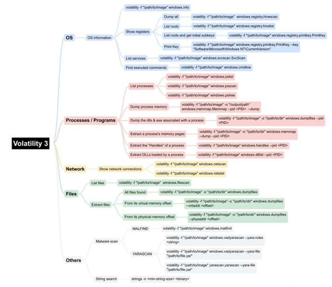

The description of those plugins helps to know which command to use according to the task.

Kali protects its Python system environment from some direct installations with `pip`, so we have to use an virtual environment `venv` to install and run Volatility 3 in an isolated environment, without changing the Python dependencies of the operating system.

```bash
#1. Create the virtual environment named 'volenv'
python3 -m venv volvenv

#2. Enable it (your command prompt will change to display '(volenv)')
source volenv/bin/activate
```

Once the virtual environment is activated, our pip manager is unlocked. We can install the prerequisites:

```bash
# Updates pip in the virtual environment
pip install --upgrade pip

# Installs the dependencies of the configuration file
pip install -r requirements.txt
```

After this, we can now launch your RAM memory analyses normally with this command:

```bash
python3 vol.py -f <file> <command>
```

## 3. Checking the dump's integrity
Before starting the analysis, we check that the MD5 hash matches the one given in the assignment

```bash
md5sum physmem.raw
```

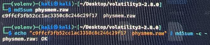

The hash matches, the file corresponds to the reference provided. We can work on it without worry.


## 4. System identification

```bash
python3 vol.py -f "./physmem.raw" windows.info
```
Excerpt from the result:

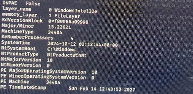

The `NtMajorVersion` and the `NtMinorVersion` represents the version of the OS: `10.0`.

Additional registry examination can help identify Windows version and build information:

```bash
python3 vol.py -f "./physmem.raw" windows.registry.printkey --key 'Microsoft\Windows NT\CurrentVersion'
```
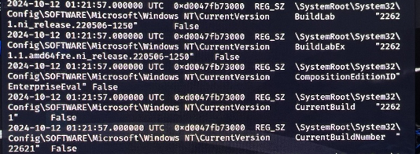

BuildNumber : `22621`

Knowing the version and the buildNumber, with google we can conclude that the machine is running on `Windows 11 Enterprise Evaluation, version 22H2, build 22621` and the release date of the 22H2 version was the `20 September 2022`.


## 5. User-account artifacts
### Name of the machine

To know the name of the machine, we have to read the registry key:

```bash
python3 vol.py -f "./physmem.raw" windows.registry.printkey --key 'ControlSet001\Control\ComputerName\ComputerName'
```
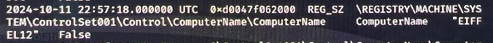

**Name of the machine** `EIFFEL12`


### IP Address of the machine

To know the local IP Address of the machine, we have to check the `LocalAddr` that goes over all the connections:

```bash
python3 vol.py -f "./physmem.raw" windows.netstat
```
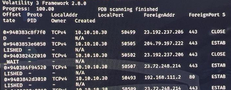

Tha address `10.10.10.30` appears as `LocalAddr`on all the connexions.

**Local IP Address** : `10.10.10.30`

### Password of the user John

To find the password in plain text of the user `John` we have to extract the hashes from the SAM database (It retains information about local user accounts, user groups (aliases) and password hashes (NTLM) for stand-alone or working group machines.):

```bash
python3 vol.py -f "./physmem.raw" windows.hashdump
```
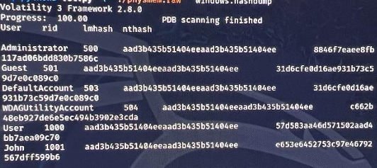

So we get John's NT hash. An NT hash is just an MD4 of the password encoded in UTF-16LE, so we can crack it with a free web-based hash matching search service such as CrackStation.

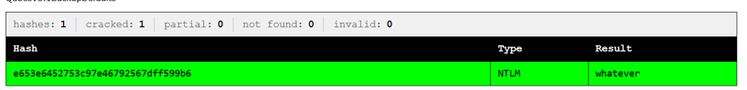

**John's password:** `whatever`


## 6. Suspicious executable discovery
### Identification of a malware
First, we display the process tree:

```bash
python3 vol.py -f "./physmem.raw" windows.pstree
```

While going through the tree, one process is clearly suspicious: an executable launched from John's Downloads folder, with a name that doesn’t look legitimate at all:

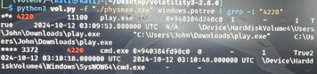
```bash
explorer.exe (11100) 
└─ play.exe (4220)   C:\Users\John\Downloads\play.exe 
    └─ cmd.exe (3372)
```

We confirm with `malfind`, which is used to detect injected/hidden code:
```bash
python3 vol.py -f "./physmem.raw" windows.malfind | grep -i "play.exe"
```

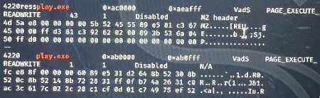

The `windows.malfind` plugin identified suspicious memory regions associated with `play.exe` **(PID 4220)**. The presence of executable memory regions containing an MZ header may indicate a mapped or injected PE executable. However, these characteristics alone do not prove malicious activity.

Combined with the suspicious process tree, the execution of `cmd.exe`, the SSH service configuration and the modification of the hosts file, these findings strengthen the hypothesis of malicious behavior.

**Suspected executable:** `play.exe`  
**Reported absolute path:** `C:\Users\John\Downloads\play.exe`

### Parent process of the malware
According to the tree, the parent of `play.exe` **(PID 4220)** is `explorer.exe` **(PID 11100)**.

- **Role of the process:** `explorer.exe` is the graphic interface of Windows(desktop, taskbar, file explorer). Everything that is launched as a child of explorer.exe has been opened manually by the user.

- **Did the user play a role in the breach? Yes and No** I think that the user had a directly role in downloading the executable on the web but, indirectly he had a role in lauching an automated script because maybe he didn’t know that it was compromised. He taught that it’s was a game.

### Child process launched by the malware
Still according to the tree, we can see that `play.exe` started a child process:

- **Child process ID:** `3372`  
- **Child process name :** `cmd.exe`

We check what this cmd.exe is doing with the command lines found in memory (`cmdline` + strings from the dump). Notably, we find the setup of an SSH server and a modification of the hosts file:

```bash
Set-Service -Name sshd -StartupType 'Automatic'
Start-Service sshd
echo 192.168.111.2     game.com >> hosts
```
The malware uses `cmd.exe` to set up remote access **(SSH)** and redirect the `game.com` domain to the attacker's IP.

### IP of the malware's HTTP connection
```bash
python3 vol.py -f "./physmem.raw" windows.netstat
```
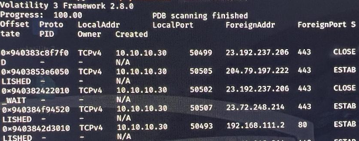

The http connection is on the port 80, and as you can see there is a connection ESTABLISHED between the IP Adress of the computer (10.10.10.30) and another foreign IP Adress which is `192.168.111.2`.

**IP of the malware's HTTP connection:** `192.168.111.2`.

## 7. Malware memory dump + attacker's domain
We dump all the memory of the malicious process:
```bash
mkdir -p ./dumped
python3 vol.py -f "./physmem.raw" -o ./dumped windows.memmap --pid 4220 --dump
```

Then we look for the IP found earlier with `strings`:
```bash
strings -a ./dumped/pid.4220.dmp | grep -iE "192.168.111.2"
```

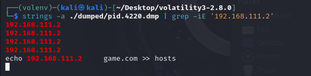


We can see that the IP `192.168.111.2` is associated with the domain `game.com`, and that the malware itself was downloaded from `http://game.com/play.exe`

**Domain used by the attacker** `game.com`.


## 8. Conclusion

Putting everything back in order, here's what happened on the EIFFEL12 machine: 
1. The user John (password whatever) downloaded a file `play.exe` from **http://game.com/play.exe** thinking it was a game. 

2. He ran the file himself from his Downloads folder (parent = **explorer.exe**). 

3. `play.exe` contains code injected into memory (RWX area with MZ header detected by malfind). 

4. The malware launches a `cmd.exe` **(PID 3372)** that: modifies the hosts file to point `game.com` to `192.168.111.2`, and activates and starts an OpenSSH server **(sshd)** to allow remote access. 

5. The malware communicates over HTTP **(port 80)** with the attacker at `192.168.111.2` (domain **game.com**).


This memory forensics investigation demonstrated how a Windows RAM dump can be used to reconstruct suspicious activity without executing the suspected malware.

Using Volatility 3, I identified system information, recovered user-account artifacts, investigated suspicious processes, and examined network communications.

One of the most interesting findings was the relationship between `explorer.exe`, `play.exe`, and `cmd.exe`, combined with commands related to SSH configuration and local DNS resolution through the hosts file.

**Key takeaway:** Memory forensics is not simply about running tools and collecting results. It is about interpreting evidence, validating hypotheses, and reconstructing events while acknowledging the limitations of the available data.